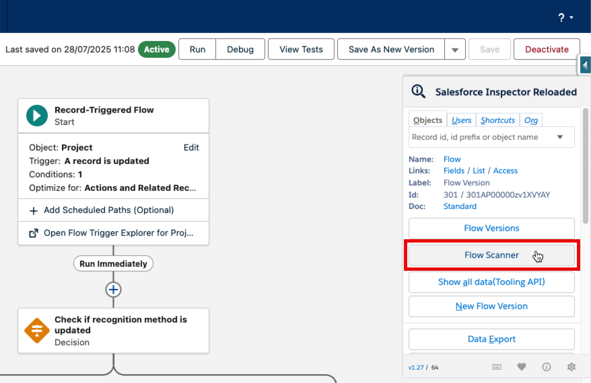
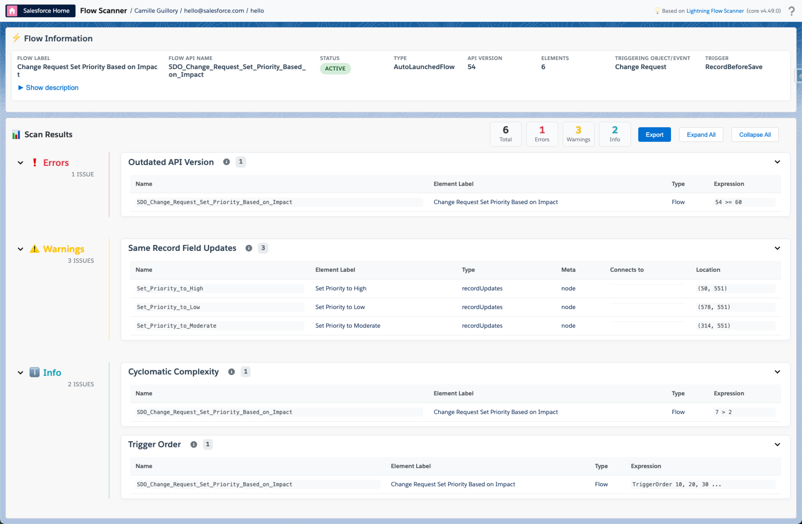
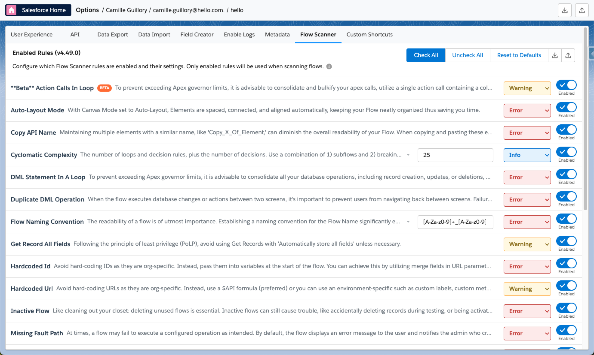
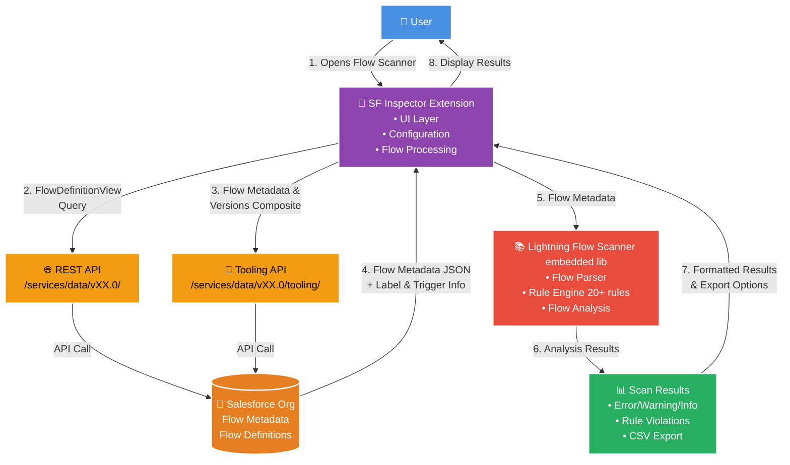

# Flow Scanner User Guide

The **Flow Scanner** is a powerful tool built into SF Inspector that helps you analyze Salesforce Flows for best practices, errors, and potential issues. This guide explains how to use the Flow Scanner, what to expect, and how to get the most out of your flow analysis.

---

## What is the Flow Scanner?

The Flow Scanner automatically reviews your Salesforce Flows and checks them against a set of rules and best practices. It helps you:

- Identify errors, warnings, and improvement opportunities in your flows
- Understand where issues are located and what they mean
- Export scan results for documentation or sharing

**Built on Lightning Flow Scanner Core**

The Flow Scanner in SF Inspector is powered by the [Lightning Flow Scanner](https://github.com/Flow-Scanner/lightning-flow-scanner), an open-source rule engine capable of conducting static analysis on Salesforce Lightning Flows, Process Builders, and Workflows. This core library provides the comprehensive rule definitions and scanning capabilities that make the Flow Scanner so powerful.

---

## How to Launch the Flow Scanner

1. **Open SF Inspector** from any Salesforce page in Safari.
2. Navigate to a Salesforce Flow in your org.
3. Look for the **Flow Scanner** button or option (usually available in the Inspector's UI when viewing a Flow):
    

    > **Note**
    > The **Flow Scanner** button (and the **Flow Versions** and **Flow Compare** buttons next to it) only appears for flows that SF Inspector can resolve to a Flow version or Flow definition record in your org (Package State: **Unmanaged**). It is not available for managed-installed flows. See [Limitations](#limitations).

4. Click the **Flow Scanner** button to open the scanner overlay.

---

## What Does the Flow Scanner Analyze?

- **Flow Metadata:** The scanner fetches the flow's structure, elements, and configuration directly from Salesforce.
- **Best Practice Rules:** It checks your flow against a set of rules (e.g., naming conventions, API version, complexity, missing fault paths, etc.).
- **Customizable Checks:** You can enable or disable specific rules in the Inspector's Options page under the Flow Scanner tab.

---

## Understanding the Scan Results

After scanning, you'll see a results panel with:

- **Summary Statistics:**
  - Total issues found
  - Number of errors, warnings, and informational messages
- **Detailed Results:**
  - Issues grouped by severity (Error, Warning, Info)
  - Each rule violation is listed with details about the affected flow element
  - Click on a rule or severity group to expand/collapse details

**Severity Levels:**

- **Error:** Critical issues that should be fixed
- **Warning:** Potential problems or risky patterns
- **Info:** Recommendations or minor suggestions

Exemple of a scan result:


**No Issues?**

- If your flow passes all checks, you'll see a success message: "No Issues Found. Great job!"

---

## Exporting Scan Results

You can export the scan results as a CSV file for documentation or sharing:

1. Click the **Export** button in the results summary panel.
2. The CSV file will be downloaded automatically, named with your flow's name and the current date.
3. Open the CSV in Excel, Google Sheets, or any spreadsheet tool to review or share the findings.

---

## Customizing Rules

- Go to the **Options** page of SF Inspector.
- Select the **Flow Scanner** tab.
- Enable or disable rules as needed, or adjust rule settings (like API version threshold or naming patterns).
- Re-run the scan for updated results.

Option page:


---

## Purging Old Flow Versions

Over time, flows can accumulate many stored versions in Salesforce. Flow Scanner includes a **Purge Old Versions** feature to help you clean up obsolete versions safely.

### What the Purge Feature Does

- Deletes **old, non-active versions** of the current flow.
- Optionally deletes any **Flow Interviews** (in-progress runs) related to those versions before removing the versions themselves.
- Uses the Salesforce **Composite API**, so multiple versions and interviews are deleted efficiently in batches.

### How to Use It

1. Open Flow Scanner on a specific flow.
2. In the **Flow Information** panel, look for the **Versions** value and the trash/bin button next to it.
   - The bin button only appears if the flow has **more than one version** (there is something to purge).
3. Click the bin button to open the **Purge Old Versions** dialog.
4. Choose the **number of previous versions to keep** (in addition to the current version).
5. Review the summary text telling you how many versions will be deleted and how many will be kept.
6. Confirm the purge.

Flow Scanner then:

- Finds all versions older than the ones you chose to keep (plus the active version) and marks them for deletion.
- Looks up and deletes related Flow Interviews for those versions.
- Deletes the old versions themselves using the Tooling API.
- Shows a **Purge Results** dialog with per-version status:
  - Version number
  - Flow status (Deleted/Failed)
  - Interviews deleted (or "No interviews" if none existed)
  - Any error message returned by Salesforce

### Version Limit & Color Indicator

Salesforce allows **up to 50 stored versions per flow**. To help you see how close you are to that limit, Flow Scanner displays the version count with a colored badge:

- **Green**: few versions stored (far from the limit).
- **Yellow/Orange**: moderate number of versions.
- **Red**: near the 50-version limit.

You can hover over the small **info icon** next to "Versions" to see a short explanation of the 50-version limit and what the badge color means.

Using the purge feature periodically helps keep your org clean and avoids hitting the maximum number of versions for critical flows.

## Comparing Flow Versions

SF Inspector provides quick access to Salesforce's Flow Compare feature, which allows you to visually compare different versions of a flow side-by-side in the Flow Builder.

### What is Flow Compare?

Flow Compare is a Salesforce feature that enables you to:

- View two flow versions side-by-side
- Identify differences between versions
- Understand what changed between versions
- Review changes before deploying or activating a flow

For more details, see the [official Salesforce documentation](https://help.salesforce.com/s/articleView?id=release-notes.rn_automate_flow_mgmt_compare_versions.htm&release=258&type=5).

### How to Access Flow Compare

1. Open Flow Scanner on any flow
2. In the **Flow Information** panel, look for the **Versions** section
3. Click the icon (🔄) next to the version count
4. This opens Flow Builder with the current flow version set for comparison

## Accessibility & Shortcuts

- **Keyboard Navigation:**
  - Use <kbd>Tab</kbd> to move between buttons and sections
  - Press <kbd>Enter</kbd> or <kbd>Space</kbd> to expand/collapse result groups

---

## Technical Architecture

### How the Flow Scanner Page Works

The Flow Scanner follows a multi-step process to analyze your Salesforce Flows:



### Data Flow Process

1. **Metadata Retrieval**

   Two requests are sent in parallel:

   - POST `/services/data/vXX.0/tooling/composite` (`allOrNone: false`) with two GET sub-requests against the Tooling API:
     - `SELECT Id,Metadata FROM Flow WHERE Id='{FlowId}'` (reference `flow`) → the flow version's full definition, returned as a JSON object in the `Metadata` field
     - `SELECT Id,VersionNumber,Status FROM Flow WHERE DefinitionId='{FlowDefinitionId}' ORDER BY VersionNumber DESC` (reference `versions`) → all versions of the flow, used for the version badge, Purge and Compare features
   - GET `/services/data/vXX.0/query/?q=SELECT Label,ApiName,ProcessType,TriggerType,TriggerObjectOrEventLabel FROM FlowDefinitionView WHERE DurableId='{FlowDefinitionId}'`
     → label, API name and trigger information
2. **Flow Metadata Processing**

   Empty (`null`) attributes are stripped from the returned metadata object, then the metadata is handed to the embedded Lightning Flow Scanner Core:

   ```javascript
   // Lightning Flow Scanner Core processes the flow metadata object
   const flow = new flowScannerCore.Flow(flowApiName, flowMetadata);
   const parsedFlow = {flow, name: flowApiName};
   const scanResults = flowScannerCore.scan([parsedFlow], ruleConfig);
   ```

3. **Rule Execution**
   - Each enabled rule runs against the parsed Flow object
   - Rules check different aspects: elements, variables, metadata, connections
   - Results categorized by severity: Error, Warning, Info
4. **Result Presentation**
   - Results aggregated and displayed in interactive UI
   - Export functionality generates CSV reports
   - Users can expand/collapse rule categories

### API Integration Details

**Salesforce REST API Endpoints Used:**

- `/services/data/vXX.0/tooling/composite` - Flow metadata and version retrieval, and batched deletion of old flow versions (`DELETE /tooling/sobjects/Flow/{Id}` sub-requests) when purging
- `/services/data/vXX.0/tooling/query/` - SOQL queries for Flow information (flow versions, resolving the Flow definition from a flow version id)
- `/services/data/vXX.0/query/` - FlowDefinitionView and Flow Interview queries
- `/services/data/vXX.0/composite` - Batched deletion of Flow Interviews (`DELETE /sobjects/FlowInterview/{Id}` sub-requests) when purging old versions

**Authentication**: Leverages the existing SF Inspector Salesforce session (handled globally by extension)

---

## Generate Flow Analysis with Agentforce

> **Prerequisite**
> Agentforce needs to be enabled.
> The prompt DescribeFlow needs to be deployed in the org.

You can use Agentforce to generate detailed flow analysis directly from the Flow Scanner page. This feature leverages Salesforce's Prompt Templates to help you understand what your flow does, when it executes, and what business purpose it serves.

> **Note**
> The standard Salesforce 'Prompt Template User' permission is required to use this feature.

By default, the Agentforce button is hidden. To enable it:

1. Go to Options -> Flow Scanner
2. Enable "Show Agentforce button"
3. Optionally, you can customize the prompt template name that will be used for generating flow analysis

### How to Use

1. Open Flow Scanner on any flow
2. Click the Agentforce (Einstein) button in the header
3. The modal will open with a default prompt: "Based on the following Salesforce Flow metadata, explain in one paragraph what this flow does, what event triggers it, and the business purpose it serves."
4. You can modify the prompt or use the default one
5. Click **Send** to generate the analysis
6. The analysis result will appear below the instruction textarea in an SLDS box

The Agentforce feature sends the flow's metadata (the JSON metadata retrieved by the scanner) to the prompt template and provides insights about:

- What the flow does
- What events trigger it
- The business purpose it serves
- Key components and their relationships
- Decision logic and data handling

DescribeFlow.genAiPromptTemplate meta content:

```xml
<?xml version="1.0" encoding="UTF-8"?>
<GenAiPromptTemplate xmlns="http://soap.sforce.com/2006/04/metadata">
    <activeVersionIdentifier>kHV1dE2/3c+Ln69ej5g+TuywC22Qn/hIXhG7gDkb9JA=_1</activeVersionIdentifier>
    <description>Based on a flow metadata, describe what the flow does, when it is executed and what are the metadata it interact with</description>
    <developerName>DescribeFlow</developerName>
    <masterLabel>Describe Flow</masterLabel>
    <templateVersions>
        <content>As a Salesforce expert in Flow and based on those metadata: {!$Input:FlowMetadata}, perform an analysis as detailed in this description: {!$Input:Description}

Instructions:**
1. Output the generated analysis clearly enclosed within &lt;flowAnalysis&gt; tags.
</content>
        <inputs>
            <apiName>Description</apiName>
            <definition>primitive://String</definition>
            <masterLabel>Description</masterLabel>
            <referenceName>Input:Description</referenceName>
            <required>true</required>
        </inputs>
        <inputs>
            <apiName>FlowMetadata</apiName>
            <definition>primitive://String</definition>
            <masterLabel>Flow Metadata</masterLabel>
            <referenceName>Input:FlowMetadata</referenceName>
            <required>true</required>
        </inputs>
        <primaryModel>sfdc_ai__DefaultOpenAIGPT4OmniMini</primaryModel>
        <status>Published</status>
        <versionIdentifier>kHV1dE2/3c+Ln69ej5g+TuywC22Qn/hIXhG7gDkb9JA=_1</versionIdentifier>
    </templateVersions>
    <type>einstein_gpt__flex</type>
    <visibility>Global</visibility>
</GenAiPromptTemplate>
```

---

## Limitations

### Managed-installed flows

Flow Scanner, **Flow Versions** and **Flow Compare** are not available for **managed-installed** flows (Package State: *Managed - Installed* in the Flows list view), such as flows that come from Salesforce itself or from an installed package. When you open one of these flows and click the SF Inspector icon, these buttons simply do not appear in the popup.

**Why:** Flow Builder opens such a flow by API name and version instead of by a flow version id, for example
`/builder_platform_interaction/flowBuilder.app?flowId=standard_approvals__ChkFlowApiName-1`.
SF Inspector only recognises a `301…` flow version id (or a `300…` flow definition id) in the page URL, and it needs that id to look up the Flow definition through the Tooling API. Managed-installed flows have no Flow or FlowDefinition record in the Tooling API, so their metadata cannot be retrieved for scanning and the flow actions stay hidden.

**Workaround:** If Flow Builder offers **Save As** for the flow (as it does for template flows), save a copy. The copy is an unmanaged flow with a real flow version id, so Flow Scanner and the other flow actions work on it.

---

## Troubleshooting

- **Flow Scanner button not shown:** Check the flow's Package State in Setup → Flows. Managed-installed flows cannot be scanned (see [Limitations](#limitations)).
- **No Rules Enabled:** If you see a message about no rules being enabled, open the Options page and enable at least one rule.
- **Initialization Error:** If the scanner fails to load, check your network connection and ensure you're logged into Salesforce.
- **Unsupported Flow Type:** Some flow types may not be supported. The scanner will list which types are supported if this occurs.
- **Still Stuck?** Check the browser console for errors or reach out to the extension's support channels.

---

## Tips & Best Practices

- Regularly scan your flows to catch issues early.
- Review errors and warnings before deploying flows to production.
- Use the export feature to document compliance or share findings with your team.
- Keep the extension updated for the latest rules and improvements.
